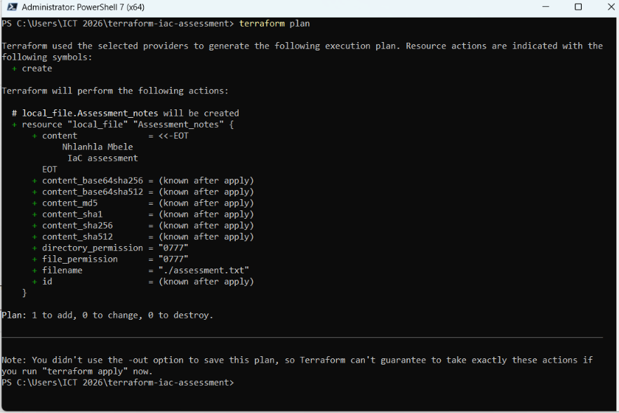
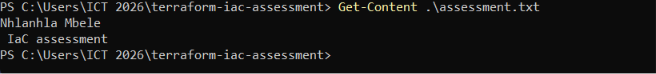

# MZ−UCA Cloud Engineering
## Day 08 − Terraform Fundamentals
#Objective
-To define and manage infrastructure using configuration file.
-Write Terraform configuration that describes the file's name and contents using Terraform.
-Use Terraform to create and manage that file.
#Format configuration 
-terraform fmt validates the Terraform configuration files by checking if the files adhere to standard formatting  Terraform rules.

#Initialize Terraform
-terraform init command is used to prepare the working directory and it downloads the essential provider plugins.

#Validate the configuration 
-terraform validate checks if the configuration syntax is correct and accurately consistent internally.
 
#Review the Plan
-terraform plan it calculates and shows various actions to implement. Review is at this phase.

#Apply the configuration
-terraform apply implements the proposed infrastructure changes that were reviewed in the previous stage.

#Verify the Result
-Check the file's contents using Get-Content .\assessment.txt
